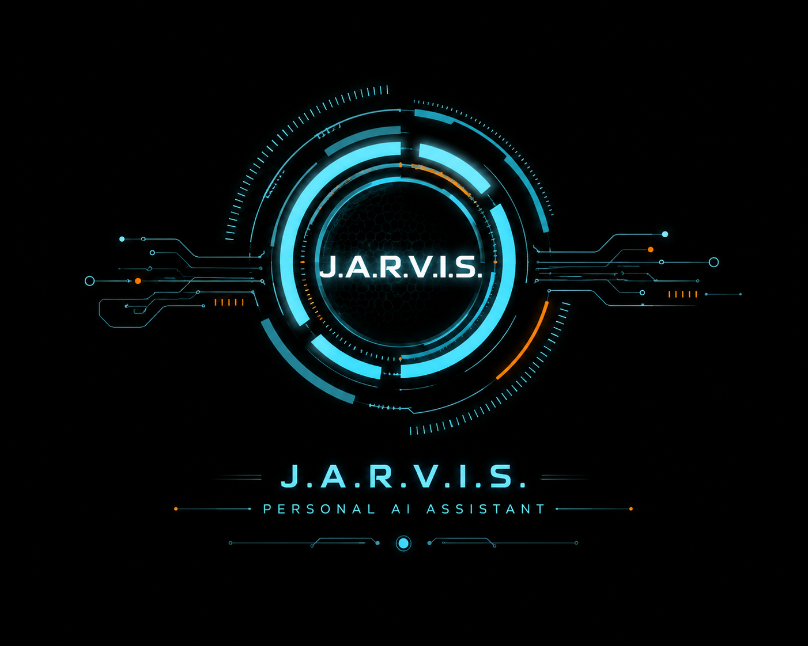

# J.A.R.V.I.S — Local-First Personal AI Assistant Workstation

**WORK IN PROGRESS!!**

> **Just A Rather Very Intelligent System** — A private, local-first AI command workstation powered by **[Ollama](https://ollama.com)**, featuring streaming chat with smart model routing, **Xfill** grounded Office document auto-fill (`.docx`, `.xlsx`, `.pptx`), **Xslide** 16:9 PowerPoint deck generation with consent-gated web imagery, persistent memory, voice synthesis/dictation, and built-in creator copyright verification.



---

## Table of Contents

- [Core Features](#core-features)
- [Prerequisites](#prerequisites)
- [Installation Guide](#installation-guide)
  - [1. Install Ollama](#1-install-ollama)
  - [2. Pull Local AI Models](#2-pull-local-ai-models)
  - [3. Clone & Install J.A.R.V.I.S](#3-clone--install-jarvis)
  - [4. Optional Cloud Fallback (.env)](#4-optional-cloud-fallback-env)
  - [5. Start J.A.R.V.I.S](#5-start-jarvis)
- [Feature Walkthrough](#feature-walkthrough)
  - [Assistant (Chat, Routing & Voice)](#assistant-chat-routing--voice)
  - [Xfill (Grounded Document Auto-Fill)](#xfill-grounded-document-auto-fill)
  - [Xslide (Local PowerPoint Generator)](#xslide-local-powerpoint-generator)
- [Keyboard Shortcuts](#keyboard-shortcuts)
- [Troubleshooting](#troubleshooting)
- [Tech Stack](#tech-stack)
- [License & Creator Attribution](#license--creator-attribution)

---

## Core Features

- **Local-First Architecture (Ollama Primary + Optional Cloud Fallback)**
  - Runs 100% locally against your own Ollama server (`http://localhost:11434`)—no cloud API key required.
  - Automatically falls back to Gemini Cloud only if local Ollama is offline **and** `GEMINI_API_KEY` is configured.
- **Assistant — Streaming Chat & Sticky Model Routing**
  - Real-time Server-Sent Events (SSE) token streaming with Stop, Edit, Regenerate, and Copy controls.
  - **Sticky Auto-Routing**: Automatically switches between your fast general model (`qwen2.5:3b`) and your coding model (`qwen2.5-coder:7b`) when programming topics are detected, staying sticky across coding threads so Ollama doesn't waste time swapping weights.
  - Rich Markdown rendering with syntax-highlighted code blocks and 1-click copy.
  - Multi-session conversation history with live search, inline rename, delete, and Markdown (`.md`) transcript export.
  - Built-in **Memory Bank** (`remember key=value`, `recall key`, `forget key`) injected directly into prompts, plus instant local commands (`/status`, `/calc`, `/code`, `/help`).
  - **Voice Input (STT) & Speech Output (TTS)** with mute toggle, voice selection, pitch/rate tuning, and automatic code-block stripping before speaking.
  - **Live Engine Diagnostics**: Real active provider status, Ollama probe ping (ms), Time-to-First-Token (TTFT), and streaming throughput (`tok/s`).
- **Xfill — Grounded Document Auto-Fill (`.docx`, `.xlsx`, `.pptx`)**
  - Upload Word documents, Excel spreadsheets, or PowerPoint decks (or load built-in 1-click sample files).
  - Deterministically parses Office XML/workbooks to detect explicit placeholders (`{{...}}`, `[...]`, `____`, `<...>`), labelled blank fields (`Answer:`, `Name: ____`), Q&A pairs, and empty spreadsheet answer columns without letting the LLM rewrite document structure.
  - Low-hallucination grounded solver (`temperature: 0.1`, JSON-constrained output) prioritizes **Memory Bank → Context Notes → Verified Knowledge**, and flags unknown private/personal fields as `[NEEDS INPUT]` instead of fabricating values.
  - Review, filter, edit answers inline, regenerate single fields, save answers directly to Memory (`Remember`), and export the updated `.docx`, `.xlsx`, or `.pptx` with original styling preserved.
- **Xslide — Local PowerPoint (`.pptx`) Generator with Consent-Gated Web Images**
  - Drafts complete 16:9 presentations (`5`–`12` slides) with structured layouts (`Title Hero`, `Split + Image`, `Bullets`, `Two Column`, `Key Metric`), crisp bullet points, and presenter **Speaker Notes**.
  - **4 Visual Theme Presets**: `Obsidian & Orange`, `Editorial Ivory`, `Slate Executive`, and `Emerald Tech`, with a live proportional 16:9 preview canvas.
  - **Explicit Consent-Gated Web Images**: Outbound image search is locked off by default (enforced in both UI and server HTTP `403` guard). Once you explicitly approve access in the Consent Dialog, browse and attach royalty-free visuals from **Wikimedia Commons** & **Openverse**—only short 2–5 word visual keywords are sent, never your private notes or Memory Bank.
  - Compiles and downloads an offline-ready `.pptx` file with approved images embedded directly inside the presentation alongside your Speaker Notes.
- **Hardened Creator Attribution & Integrity Guard**
  - Cryptographically sealed Copyright Management Information (`J.A.R.V.I.S (c) 2026 cosmoknight`, Seal `ceff726d5d41618b`) verified across client, server headers, build pipeline, and GitHub Actions CI.

---

## Prerequisites

Before installing J.A.R.V.I.S, make sure your machine has:

| Requirement | Minimum | Recommended |
|---|---|---|
| **Operating System** | Windows 10/11, macOS 13+, or Linux | 64-bit OS |
| **Node.js** | v20.0 or higher | v20 LTS / v22 LTS |
| **Ollama** | Latest release | Latest release |
| **RAM** | 8 GB (runs `qwen2.5:3b`) | 16 GB+ (runs `qwen2.5-coder:7b` smoothly) |
| **Disk Space** | ~3 GB free | ~10 GB free (for multiple local models) |

---

## Installation Guide

### 1. Install Ollama

Download and install Ollama for your operating system:

- **Windows & macOS:** Download the official installer from [https://ollama.com/download](https://ollama.com/download) and run it.
- **Linux:**
  ```bash
  curl -fsSL https://ollama.com/install.sh | sh
  ```

Verify the installation in your terminal:

```bash
ollama --version
```

### 2. Pull Local AI Models

Pull the default models used by J.A.R.V.I.S's sticky auto-router, **Xfill**, and **Xslide**:

```bash
# Fast general assistant, Xfill document solver, and Xslide outline generator (~1.9 GB)
ollama pull qwen2.5:3b

# Dedicated coding & technical reasoning model for auto-routing (~4.7 GB)
ollama pull qwen2.5-coder:7b
```

#### Optional: Custom Fine-Tuned `vai-doc:latest` Model (Recommended for Xfill & Xslide)

J.A.R.V.I.S routes **Xfill** and **Xslide** to `vai-doc:latest` by default (with automatic local fallback to `qwen2.5:3b` if `vai-doc:latest` is not installed yet). To register your quantized `vai-doc.gguf` file with Ollama:

1. Place `vai-doc.gguf` inside the `models/` folder (all `*.gguf` files are gitignored so model weights are never committed to GitHub).
2. Build the Ollama model from the included Modelfile (`num_ctx 8192` + ChatML stop tokens):

```bash
ollama create vai-doc:latest -f models/Modelfile.vai-doc
```

3. You can switch the active Xfill or Xslide model anytime from **Settings** or directly inside the **Xfill** / **Xslide** headers.

*(Optional — only needed if you want local image/vision analysis)*:

```bash
ollama pull llama3.2-vision:latest
```

Confirm your models are installed:

```bash
ollama list
```

Make sure the Ollama server is running (on Windows/macOS the tray app starts it automatically; on Linux or if stopped, run):

```bash
ollama serve
```

> By default, Ollama listens on `http://localhost:11434`. You can change this URL anytime inside J.A.R.V.I.S **Settings**.

### 3. Clone & Install J.A.R.V.I.S

```bash
# Clone the repository
git clone https://github.com/cosmoknight/JARVIS.git
cd JARVIS

# Install dependencies
npm install
```

*(Replace the clone URL above with your repository's exact GitHub URL.)*

### 4. Optional Cloud Fallback (`.env`)

J.A.R.V.I.S works **100% locally with Ollama** with zero API keys.

If you also want automatic Gemini Cloud fallback whenever your local Ollama service is stopped:

```bash
cp .env.example .env
```

Then edit `.env` and add your key:

```env
GEMINI_API_KEY=your_api_key_here
```

### 5. Start J.A.R.V.I.S

**Development mode:**

```bash
npm run dev
```

**Production build & start:**

```bash
npm run build
npm start
```

Open your browser and go to:

```text
http://localhost:3000
```

---

## Feature Walkthrough

### Assistant (Chat, Routing & Voice)

- Type naturally or switch models (`auto`, `qwen2.5:3b`, `qwen2.5-coder:7b`, or any model installed in Ollama) directly from the composer.
- Store persistent personal or project facts using natural commands:
  - `remember company=Acme Labs`
  - `recall company`
  - `forget company`
  - `show memory`
- Run built-in zero-latency utility commands:
  - `/status` — display live provider status, probe latency, and model routing
  - `/calc (256 * 16) + 1024` — instant math evaluation
  - `/code <prompt>` — force routing to your coding model
  - `/clear` or `/export` — clear current chat or download a `.md` transcript

### Xfill (Grounded Document Auto-Fill)

1. Click the neon cyan **`Xfill`** tab in the top navigation bar.
2. Upload any `.docx`, `.xlsx`, or `.pptx` form/questionnaire (up to 12 MB)—or click **Word `.docx`**, **Excel `.xlsx`**, or **Slide `.pptx`** to test immediately with built-in samples.
3. *(Optional)* Paste reference facts into **Context Notes**, pick an answer style (`Concise`, `Detailed`, `Bullets`), or enable **Strict Context-Only Mode** to restrict answers strictly to your Memory Bank and notes.
4. Click **Auto-Fill Detected Fields**. Unknown private details (e.g., phone numbers, employee IDs) are safely marked `[NEEDS INPUT]` instead of hallucinated.
5. Review or edit any answer inline, click **Remember** to save useful facts into J.A.R.V.I.S Memory, and click **Export Updated File** to download the completed document with original formatting preserved.

### Xslide (Local PowerPoint Generator)

1. Click the neon cyan **`Xslide`** tab in the top navigation bar.
2. Enter your presentation topic, choose slide count (`5`–`12`), audience tone (`Executive`, `Technical`, `Educational`, `Pitch`), optional grounding notes, and pick one of the **4 Visual Theme Presets**.
3. Click **Generate Deck** to draft the structured outline and speaker notes via local Ollama.
4. *(Optional)* Click **Allow Web Images** and approve the explicit **Web Access Consent Dialog** to search and preview royalty-free visuals from Wikimedia Commons / Openverse per slide (or batch-fill visuals). You can revoke web access anytime with **Revoke Web**.
5. Edit titles, bullets, layouts, slide order, and **Presenter Speaker Notes** while watching the live 16:9 canvas update, then click **Export `.pptx`** to download an offline-ready PowerPoint deck.

---

## Keyboard Shortcuts

| Shortcut | Action |
|---|---|
| `Enter` | Send message in Assistant |
| `Shift + Enter` | Insert newline in composer |
| `↑` / `↓` | Cycle previous prompt history |
| `Ctrl / Cmd + K` | Open Commands & Guide modal |
| `Ctrl / Cmd + L` | Clear active conversation view |
| `Ctrl / Cmd + E` | Export active conversation as Markdown (`.md`) |
| `Ctrl / Cmd + M` | Toggle TTS voice synthesis mute |
| `Esc` | Close active modal / drawer |

---

## Troubleshooting

- **Ollama shows as Offline in Engine Diagnostics**
  - Verify Ollama is running by visiting `http://localhost:11434/api/tags` in your browser or running `ollama serve`.
  - If Ollama runs on another port or LAN machine, update **Ollama Host URL** inside **Settings** and click **Probe**.
- **First response feels slow**
  - The first request after starting Ollama loads model weights into RAM/VRAM. J.A.R.V.I.S sends `keep_alive: 30m` (configurable in **Settings**) so subsequent replies stay instant.
- **Model not found error**
  - Run `ollama list` and verify the selected model name matches an installed tag (e.g., `ollama pull qwen2.5:3b`).
- **Build fails with `[COPYRIGHT INTEGRITY CHECK FAILED]`**
  - Run `npm run verify:copyright` to inspect which attribution file (`LICENSE`, `NOTICE`, `src/services/attribution.ts`, `server.ts`, or policy files) was modified. Retaining original creator attribution is required by the license.

---

## Tech Stack

- **Frontend:** React 19, TypeScript, Vite 6, Tailwind CSS v4, Lucide Icons
- **Backend:** Node.js, Express 5 (`tsx`)
- **Local AI & Optional Cloud:** Ollama REST API (`/api/chat`, `/api/tags`), `@google/genai` (server-side fallback)
- **Document & Presentation Engines:** `jszip`, `exceljs`, `pptxgenjs`

---

## License & Creator Attribution

**MIT License — with Mandatory Creator Attribution.**

Copyright (c) 2026 **cosmoknight** (`J.A.R.V.I.S (c) 2026 cosmoknight` · Seal `ceff726d5d41618b`).

You are free to use, study, modify, and redistribute this software, provided the original creator credit **"J.A.R.V.I.S — (c) 2026 cosmoknight"** is retained in the software, its documentation (`LICENSE` and `NOTICE`), and any redistributed or derivative copies. Removing, obscuring, or bypassing creator attribution is not permitted.

See [LICENSE](LICENSE) and [NOTICE](NOTICE) for full terms.
